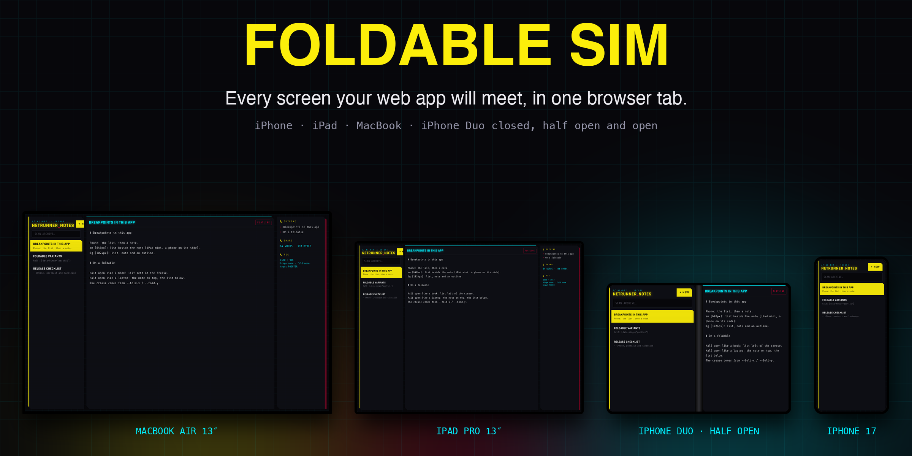
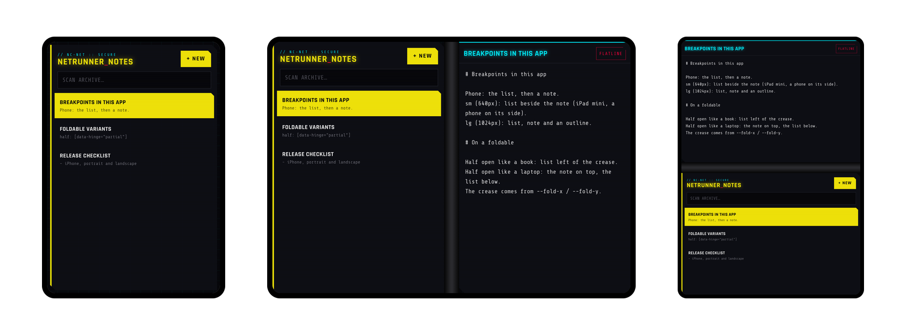

<p align="center">
  <a href="https://getpopcraft.github.io/foldable-sim/"></a>
</p>

<p align="center">
  <a href="https://getpopcraft.github.io/foldable-sim/"></a>
  <a href="LICENSE"></a>
  
</p>

<p align="center">
  <b>Paste a URL. Pick a device. Fold it.</b><br />
  Your app runs at each screen's real size and gets the hinge the way it would on the device,<br />
  on hardware that can actually draw it.
</p>

---

## Why

Foldable phones are new and their official simulators are thin: the iOS simulator has no WebGPU adapter, so
canvas-heavy apps render black. Resizing a browser window doesn't tell your app where the crease is. Foldable Sim
frames your app at the device's real CSS size and reports its posture exactly as a native shell or the
[Viewport Segments API](https://developer.mozilla.org/docs/Web/API/Viewport/segments) would, so the fold handling you
ship is the fold handling you test.

## One app, every posture

<p align="center">
  
</p>

<table align="center">
  <tr>
    <td align="center"><b>Closed</b><br /><sub>466 × 678 outer screen</sub></td>
    <td align="center"><b>Half open, book</b><br /><sub>crease at x 456–496: list left, note right</sub></td>
    <td align="center"><b>Half open, laptop</b><br /><sub>crease at y 456–496: note on top, list below</sub></td>
  </tr>
</table>

## Quick start

**Hosted** — nothing to install: open **[getpopcraft.github.io/foldable-sim](https://getpopcraft.github.io/foldable-sim/)**,
paste your dev server's URL, then switch device, posture and rotation at the bottom.

**Local** — plain files, no build:

```bash
git clone https://github.com/getpopcraft/foldable-sim && cd foldable-sim
npx serve .        # → http://localhost:3000/?url=https://localhost:5173/
```

**Deep links** open a device straight away, e.g.
[`?device=iphone-duo&posture=half&orientation=landscape`](https://getpopcraft.github.io/foldable-sim/?device=iphone-duo&posture=half&orientation=landscape).

| Parameter | Values |
|---|---|
| `url` | The app to frame. Without one, the Tailwind example opens. |
| `device` | `iphone-duo` · `iphone-17` · `iphone-17-pro-max` · `ipad-mini` · `ipad-pro-13` · `macbook-air-13` |
| `posture` | `closed` · `half` · `open` (foldables) |
| `orientation` | `portrait` · `landscape` |
| `prefix` | Same-origin apps: the name prefix your app reads (`pc` → `data-pc-hinge`) |

> [!NOTE]
> Your app must allow being framed by the simulator: no `X-Frame-Options: DENY`, and a `frame-ancestors` CSP that
> includes the simulator's origin. Production sites usually forbid it, so point it at a development URL.

## Devices

| Device | Screen (CSS px) | Touch |
|---|---|---|
| **iPhone Duo** | closed 466 × 678 · open 951 × 669, crease 40 px | ✓ |
| iPhone 17 | 402 × 874 | ✓ |
| iPhone 17 Pro Max | 440 × 956 | ✓ |
| iPad mini | 744 × 1133 | ✓ |
| iPad Pro 13″ | 1032 × 1376 | ✓ |
| MacBook Air 13″ | 1470 × 956, landscape only | — |

Sizes are measured in CSS pixels (the Duo on Xcode 27.1's simulator). Add a device in [`devices.js`](devices.js): its
screen and crease for each posture. Pull requests welcome.

## Fold-aware Tailwind in four lines

The [Tailwind example](examples/tailwind/) ([live](https://getpopcraft.github.io/foldable-sim/examples/tailwind/)) is
a working notes app with five layouts and no JavaScript layout code. It adds four variants:

```css
@custom-variant half   (&:where([data-hinge="partial"], [data-hinge="partial"] *));
@custom-variant fold-v (&:where([data-hinge="partial"][data-fold="vertical"], [data-hinge="partial"][data-fold="vertical"] *));
@custom-variant fold-h (&:where([data-hinge="partial"][data-fold="horizontal"], [data-hinge="partial"][data-fold="horizontal"] *));
@custom-variant touch  (&:where([data-touch], [data-touch] *));
```

and the panes meet exactly at the hinge:

```html
<div class="grid sm:grid-cols-[15rem_1fr] lg:grid-cols-[17rem_1fr_15rem]
            fold-v:grid-cols-[var(--fold-x)_1fr] fold-v:gap-x-[var(--fold-w)]
            fold-h:grid-rows-[var(--fold-y)_1fr] fold-h:gap-y-[var(--fold-h)]">
```

Plain CSS works the same way — [`demo/`](demo/) is the smallest possible example:

```css
html[data-hinge="partial"][data-fold="horizontal"] .app {
  display: grid;
  grid-template-rows: var(--fold-y) var(--fold-h) 1fr;
}
```

## Reference

<details>
<summary><b>The posture contract</b>: attributes, variables, event and Viewport Segments</summary>

### What your app receives

When it's framed, the page gets the same facts a native shell or browser would report. For example, after the simulator half-opens the device:

```html
<html data-hinge="partial" data-fold="horizontal" data-touch
      style="--fold-x: 0px; --fold-y: 456px; --fold-w: 669px; --fold-h: 40px">
```

| What | Meaning |
|---|---|
| `data-hinge` | `closed`, `partial` (half open), `open`, `none` (no hinge: a phone, tablet or laptop) or `unknown` |
| `data-fold` | `none`, `vertical` (the device is held like a book) or `horizontal` (held like a laptop) |
| `--fold-x/y/w/h` | The crease, in CSS pixels. `0px` when there is none. |
| `data-touch` | Present while the simulated device has a touch screen (every one but the MacBook), even when you test on a laptop. |
| `foldable-posture` event | Fired on `window` after every change, with `{ hinge, fold, crease }` |
| `window.viewport.segments` | The standard [Viewport Segments API](https://developer.mozilla.org/docs/Web/API/Viewport/segments), as the simulated device would report it: one segment when flat or closed, two either side of the crease. It shadows the browser's own while framed. |

#### Cross-origin apps: include the client

Postures cross origins by `postMessage`. Add the client to your development build. It does nothing unless the page is framed.

```js
import { installFoldablePosture } from '@popcraft/foldable-sim'   // or ./client/foldable-posture.js

installFoldablePosture()                     // data-hinge, --fold-x, 'foldable-posture'
installFoldablePosture({ prefix: 'pc' })     // data-pc-hinge, --pc-fold-x, 'pc-fold'
installFoldablePosture({ origin: 'https://getpopcraft.github.io', onChange: p => console.log(p) })
```

#### Same-origin apps need nothing

If the simulator is served from the same origin as your app (for example, from a route of its dev server), it writes the posture straight onto the framed document. Pass `?prefix=` to match the names your app reads.


</details>

<details>
<summary><b>On a real device</b></summary>

On iOS, a WKWebView app can report the real hinge to the same contract: in iOS 27.1, `UIHingeInteraction` gives the
hinge status and the web view's `.division` reserved region gives the crease. Write them to the page as the
attributes and variables above. PopCraft's shell does exactly this, so the layouts you test here run unchanged on
the device.

</details>

---

<p align="center">
  Built by <a href="https://popcraft.app"><b>PopCraft</b></a>, the design tool, for its own iPhone Duo layouts, and
  opened up for everyone. · <a href="https://getpopcraft.github.io/">More PopCraft open source</a> · MIT
</p>
